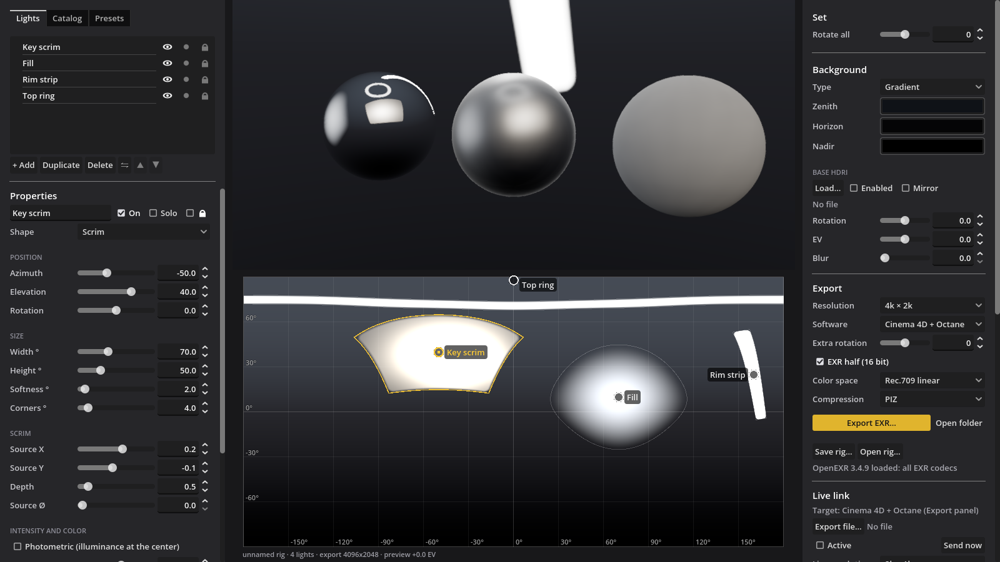

# HDRI Studio

**Build studio-lighting HDRIs from parametric lights, see them on reference spheres in real time, and
push every change live into Cinema 4D, Blender or Houdini.**

HDRI Studio is a desktop app for macOS and Windows. You place softboxes, strips, rings, scrims and
photographed light sources on a 360° sphere; the panorama is baked on the GPU and exported as a
physically correct linear EXR or Radiance `.hdr`. With the live link on, your 3D software reloads the
HDRI as you drag a light, and LightPaint lets you click on your model to put a reflection exactly
where you want it.



> **Status:** 0.10 — test builds for early users. Feedback is welcome in
> [Issues](https://github.com/lignazio/hdri-studio/issues).

## Features

**Lights**
- Shapes: rectangle, ellipse, ring, gradient (radial or linear, with colour stops), **scrim** (a
  diffuser with a physical light source behind it, so it has a real hotspot) and **texture** (any
  EXR/HDR image of a real light, e.g. a photographed softbox).
- Per light: position in azimuth/elevation, size in degrees, softness, rounded corners, intensity and
  EV, Kelvin with quick presets and gels (CTO/CTB, plus/minus green…), tint.
- Blend modes: Add (physical), Max, Multiply and Normal, with drag-and-drop ordering.
- **Photometric mode**: set the illuminance a light produces at the centre instead of its radiance —
  making a softbox bigger makes it softer, not brighter.
- Solo, lock, mirror-duplicate left ↔ right, rotate the whole set, 200 levels of undo, autosave.

**Preview**
- Chrome, glossy and diffuse spheres, or your own GLB model with test materials (golds, silver,
  platinum, copper, brushed metal, glass).
- An equirectangular map with draggable handles, a degree grid and a pixel readout.
- **LightPaint**: Shift-drag on a sphere or model and the selected light moves to produce a reflection
  under the cursor. A plain click on a reflection selects the light that makes it.
- Light meter (illuminance and EV100 in any direction) and a clipping overlay.

**Library**
- Catalog of your own HDRI-light collection, with thumbnails, tags, favourites and per-image default
  settings stored in a sidecar JSON.
- Studio presets saved as plain JSON files with a thumbnail.

**Export**
- EXR through OpenEXR 3.4.9 built into the app: every codec (PIZ, ZIP, ZIPS, RLE, NONE, PXR24, B44,
  B44A, DWAA, DWAB), half or float32. Also Radiance `.hdr`.
- 2k, 4k or 8k; linear Rec.709 or ACEScg (with AP1/D60 chromaticities in the header).
- Orientation presets measured with a calibration HDRI for **Cinema 4D + Octane**, **Cinema 4D
  native**, **Godot / Blender** and **Houdini**.
- **The rig travels inside the file.** Every exported EXR and `.hdr` carries the full light setup in
  its metadata, so *Open rig…* rebuilds the project from any HDRI you exported.

## Live link

The app runs a local server (TCP `127.0.0.1:47820`, JSON lines). Pick an export file, tick *Active*,
load the same file as your environment, and every change is written and reloaded in the 3D app.

| | Cinema 4D + Octane | Blender | Houdini |
|---|:---:|:---:|:---:|
| HDRI reloads on every change | ✓ | ✓ | ✓ |
| Creates the environment for you | ✓ | — | ✓ |
| **Separate lights** become real area lights | ✓ | ✓ (emissive planes) | ✓ (area lights) |
| LightPaint from the 3D viewport | ✓ | ✓ | — |
| Preview follows the 3D camera | ✓ | ✓ | — |

A *separate* light is left out of the HDRI and exported as its own planar EXR, then recreated in the 3D
scene as an area light at the distance you choose, so it can cast real shadows. Energy matches the
same light baked into the HDRI: measured at a ratio of 1.002 in Cycles and 0.984 in Karma (the Octane
calibration is still in progress).

Installation and usage for each plugin: [Cinema 4D](hdri_studio/plugins/c4d/README.md) ·
[Blender](hdri_studio/plugins/blender/README.md) · [Houdini](hdri_studio/plugins/houdini/README.md)
(the plugin READMEs are in Italian). Requires Blender 4.2 or later; developed on Houdini 22 and
Cinema 4D 2025/2026 with Octane.

## Download

Get the zip for your system from **[Releases](https://github.com/lignazio/hdri-studio/releases/latest)**:
it contains the app, the `plugins/` folder and the tester guide.

- **macOS** (universal): the app is not signed. The first time, right-click it → *Open*, or run
  `xattr -dr com.apple.quarantine "HDRI Studio.app"`.
- **Windows** (x86_64): SmartScreen will warn about an unknown publisher → *More info* → *Run anyway*.

The interface is in English, or Italian when your system is in Italian (switchable under
*Interface → Language*).

## Run from source

1. Install [Godot 4.7.1](https://godotengine.org/download) (the *Standard* build, not .NET).
2. Clone this repository and build Godot's import cache once:
   ```bash
   git clone https://github.com/lignazio/hdri-studio.git
   cd hdri-studio
   godot --headless --path hdri_studio --import
   ```
3. Open `hdri_studio/project.godot` in Godot and press **F5**, or run `godot --path hdri_studio`.

The OpenEXR extension ships prebuilt for macOS and Windows in `hdri_studio/addons/hs_openexr/bin/`; to
rebuild it, see `tools/build_gdextension.sh`. `tools/release.sh <version>` exports both platforms,
runs the app's self-test and publishes a release.

## Repository layout

```
hdri_studio/          the Godot project
  bake/               GPU compute shader that bakes the equirectangular panorama
  core/ ui/ preview/  rig model, interface, 3D preview and LightPaint
  export/             EXR / HDR writer and metadata
  livelink/           live link server
  plugins/            Cinema 4D, Blender and Houdini plugins
  tools/              smoke tests and verification scripts
gdextension/          C++ source of the OpenEXR extension
tools/                release, extension build, icon and splash scripts
docs/                 development notes (Italian)
GUIDA.md              tester guide (Italian)
```

The development documentation, the project diary in `PIANO.md` and the code comments are in Italian;
the app and its plugins are in English.

## License

[MIT](LICENSE) © 2026 Ignazio Lucenti — Lucenti Studio. The app embeds [OpenEXR](https://openexr.com) (BSD-3-Clause).
